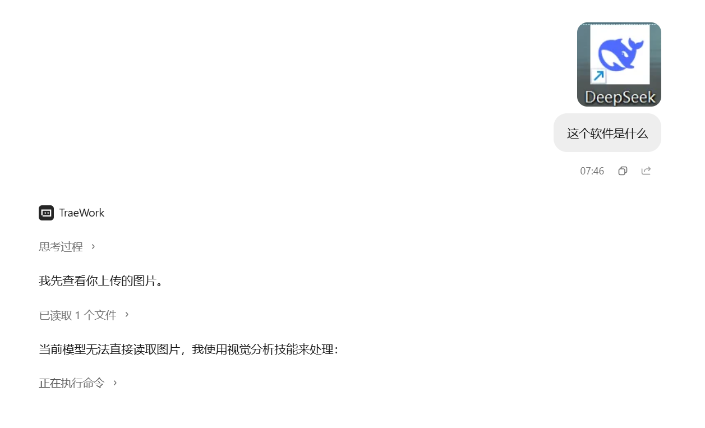
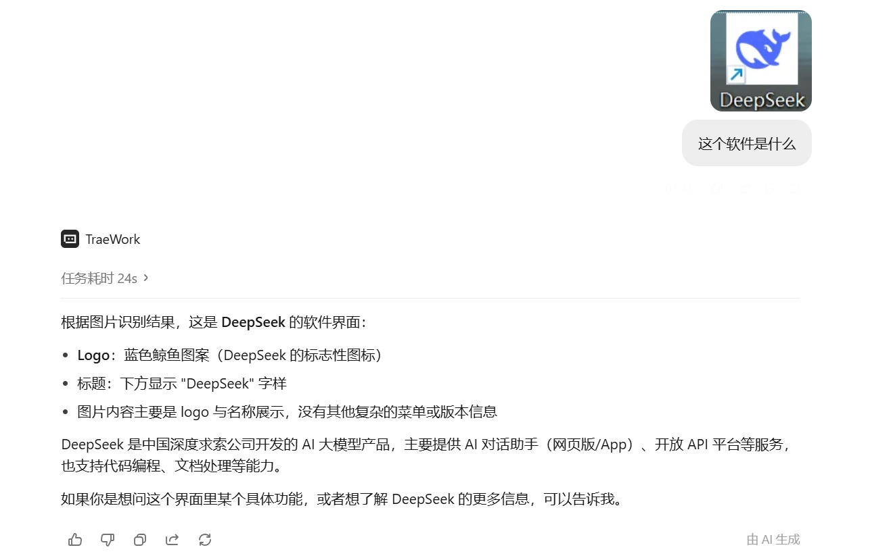
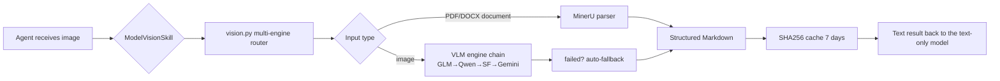

<div align="center">

# 👁️ ModelVisionSkill

### Give every non-multimodal model eyes — 6 free vision engines, one skill, ready on every agent platform

**Text-only model × free vision API = full multimodal** · $0 cost · Auto-fallback · Cached · Cross-platform

[](https://www.python.org/)
[](LICENSE)
[]()
[]()
[]()

> Your model can't read screenshots? Errors, design mockups, hand-drawn diagrams and PDFs are all invisible to it?
> **ModelVisionSkill gives it eyes** — one command, and any model without vision capability can "see".

</div>

---

## 👀 Who needs ModelVisionSkill?

**In 2026, plenty of mainstream models are still text-only** — great at reasoning, born blind. No matter which one you use, ModelVisionSkill covers it:

| Model family | Text-only (no vision) | Vision-capable | Notes |
|---|---|---|---|
| **DeepSeek** | DeepSeek-V4 / V3 / R1 (official API is text-only) | — (no public vision API) | The poster child: top-tier reasoning, zero image input |
| **Xiaomi MiMo** | MiMo-7B / V2-Flash / V2-Pro / V2.5-Pro | MiMo-VL / V2-Omni | Great reasoning per ¥; text-only editions ship everywhere |
| **Zhipu GLM** | GLM-4.5 / GLM-4.5-Air | GLM-4.6V (ModelVisionSkill's default engine) | Bootstrapping: GLM-4.5 sees through GLM-4.6V |
| **MiniMax** | MiniMax-Text | MiniMax-VL | Long-context flagship |
| **01.AI** | Yi-Lightning | — | Text-only API |
| **Baichuan** | Baichuan4 family | — | Text-only API |
| **Meta Llama** | Llama 3.1 / 3.3 | Llama 4 | The most self-hosted text-only family |
| **Mistral** | Mistral Nemo / Large | Pixtral | EU text-only workhorses |

> 💡 **Simple rule of thumb**: if a model/API rejects image input, it needs ModelVisionSkill.
> Use it inside any agent (Claude Code, Codex, OpenCode, Trae, WorkBuddy, Cursor, Reasonix, MiMo Code…) no matter which model runs underneath.

---

## 🚀 Quick start: install into your agent (3 minutes)

ModelVisionSkill is a standard **Agent Skill** — at its core a zero-dependency Python CLI. It works on any agent platform. Recommended order: **run the one-line installer, then use your platform's native Skill mechanism.**

### ① One-line install (all mainstream platforms)

```bash
git clone https://github.com/yan-stone-computer/ModelVisionSkill.git
cd ModelVisionSkill

# Auto-detect and install into every agent platform on this machine
python scripts/install.py --all

# Or install into specific platforms:
python scripts/install.py --target claude      # Claude Code
python scripts/install.py --target workbuddy   # WorkBuddy
python scripts/install.py --target trae        # Trae (project-level .trae/skills)
python scripts/install.py --target trae --global  # Trae (global)
python scripts/install.py --target codex       # OpenAI Codex
python scripts/install.py --target opencode    # OpenCode
python scripts/install.py --target cursor      # Cursor rule
python scripts/install.py --dest <any-dir>     # custom location
```

### ② Manual install per platform

| Platform | How | Where |
|---|---|---|
| **Claude Code** | Copy the project into the official skills dir | `~/.claude/skills/model-vision-skill/` |
| **WorkBuddy** | Copy into user-level skill dir | `~/.workbuddy/skills/model-vision-skill/` |
| **Trae** | Project-level / global skill dir | `.trae/skills/model-vision-skill/` or `~/.trae/skills/model-vision-skill/` |
| **OpenCode** | Agent file (Markdown) | `~/.config/opencode/agent/model-vision-skill.md` |
| **OpenAI Codex** | Agent config (YAML) | `~/.codex/agents/model-vision-skill.yaml` |
| **Cursor** | Project rule | `.cursor/rules/model-vision-skill.mdc` |
| **Reasonix** (DeepSeek ecosystem) | Clone, then use `scripts/vision.py` as a command tool, or copy into the project's skills dir | call it inside `npx reasonix code` |
| **MiMo Code** (Xiaomi ecosystem) | Same — use it as an external tool/command | call it inside the `mimo` terminal |
| **OpenClaw / others** | Follow the Agent Skills spec: drop the dir containing `SKILL.md` into the platform's skills dir | see platform docs |

> 💡 **Universal fallback**: on any platform, with any agent — just have it run:
> ```bash
> python <path-to-ModelVisionSkill>/scripts/vision.py <image-or-url> --prompt "<your question>"
> ```

### ③ Configure a free API key (optional but recommended)

MinerU document parsing and local OCR work **with no key at all**; for stronger general understanding, add a free key (Zhipu GLM is recommended — free forever).

**Easiest way — just tell your model the key.** The model persists it for you with `set_key.py`; `vision.py` loads it automatically on every run, so you only enter it once:

```bash
python scripts/set_key.py glm sk-xxxx          # Zhipu GLM (free forever)
python scripts/set_key.py gemini sk-xxxx       # Google Gemini (~1500 req/day)
python scripts/set_key.py qwen sk-xxxx         # Alibaba Qwen-VL
python scripts/set_key.py siliconflow sk-xxxx  # SiliconFlow open models
python scripts/set_key.py mineru your-token    # optional, 1000 pages/day
python scripts/set_key.py --list               # show stored keys (masked)
```

Keys are stored in `~/.vision-reader/config.json` (override with `VISION_CONFIG`) and are never echoed back in full. Real environment variables still take precedence over the config file.

Traditional way — environment variables:

```bash
export ZHIPUAI_API_KEY=your-key      # Zhipu GLM-4.6V-Flash (free forever)
export GEMINI_API_KEY=your-key       # Google Gemini (~1500 req/day)
export DASHSCOPE_API_KEY=your-key    # Alibaba Qwen-VL
export SILICONFLOW_API_KEY=your-key  # SiliconFlow open models (MiMo available here too)
export MINERU_TOKEN=your-token       # optional, 1000 pages/day
```

Windows (PowerShell):
```powershell
[Environment]::SetEnvironmentVariable('ZHIPUAI_API_KEY','your-key','User')
```

---

## ✨ Why ModelVisionSkill?

Most "give DeepSeek eyes" projects out there are **single-model MCP servers**: wire up one Qwen-VL and call it a day — it dies, you go blind again, and it only works inside the MCP ecosystem.

ModelVisionSkill is different:

- 🆓 **6 free vision engines in one kit**: GLM / Qwen / SiliconFlow / Gemini / MinerU / local OCR — all free tiers, runs even with zero API keys
- 🔄 **Auto-fallback**: if the primary engine fails, the next one takes over automatically. Never blind again
- 🧠 **Document-grade parsing**: feed PDF / Word / PPT / Excel directly; MinerU returns structured Markdown (tables + LaTeX formulas intact)
- ⚡ **SHA256 disk cache**: same image + same question = instant reply within 7 days (0.6s measured)
- 📦 **Zero third-party dependencies**: pure Python stdlib, Windows / macOS / Linux
- 🔌 **Every-platform Skill**: Claude Code, Codex, OpenCode, Trae, WorkBuddy, Cursor, Reasonix, MiMo Code… one codebase for all
- 🖼️ **Multi-image comparison, URL input, JSON output** — built for deep agent integration
- 🌍 **Model-agnostic**: DeepSeek, Xiaomi MiMo, GLM-4.5, MiniMax, Llama 3.x… every text-only model

---

## 🎯 Demo

```bash
# 1. Read an error from a screenshot (your text-only model: "I can't see it")
python scripts/vision.py error_screenshot.png --prompt "What is this error and how do I fix it?"

# 2. Extract chart values
python scripts/vision.py chart.png --prompt "Extract the key values and trends from this chart"

# 3. Multi-image comparison
python scripts/vision.py before.png after.png --prompt "Compare the differences"

# 4. Parse a whole PDF paper → Markdown (tables/formulas preserved)
python scripts/vision.py paper.pdf

# 5. Agent integration: structured JSON output
python scripts/vision.py screenshot.png --prompt "Describe the UI state" --json
```

```json
{
  "engine": "mineru",
  "model": "vlm",
  "cache_hit": false,
  "elapsed": 6.42,
  "text": "## Abstract ..."
}
```

Real output examples:





---

## 🧩 Engine kit (all free tiers)

| Engine | Default model | Key | Free tier | Strength |
|---|---|---|---|---|
| `glm` | GLM-4.6V-Flash | `ZHIPUAI_API_KEY` | **Free forever** | General vision (default) |
| `qwen` | qwen-vl-plus | `DASHSCOPE_API_KEY` | New-user quota | Chinese / OCR |
| `siliconflow` | Qwen2.5-VL-7B-Instruct | `SILICONFLOW_API_KEY` | Sign-up credits | Any open model |
| `gemini` | gemini-2.5-flash | `GEMINI_API_KEY` | ~1500 req/day | Best free visual reasoning |
| `mineru` | MinerU document parser | `MINERU_TOKEN` (optional) | Tokenless / 1000 pages/day | **PDF / tables / formulas** |
| `local` | RapidOCR (offline) | none | **Fully free** | Works without internet |

Auto-selection: **documents → MinerU; images → first configured VLM in priority order, falling back on failure, local OCR last.**

Reorder engines via env var: `export VISION_ENGINE_PRIORITY="gemini,glm,mineru,local"`

---

## 🔧 How it works



Image → free vision API → **text description** → your text-only model reasons as usual. Nothing about your model changes — it just gained eyes.

---

## ⚙️ CLI reference

```
usage: vision.py inputs [inputs ...] [--prompt PROMPT] [--engine ENGINE]
               [--fallback] [--no-fallback] [--json] [--no-cache]
               [--cache-ttl SECONDS] [--timeout SECONDS] [--debug]
```

| Flag | Description |
|---|---|
| `inputs` | Local file paths or HTTP(S) image/document URLs; multiple allowed |
| `--prompt` | The user's question, passed through to the vision model verbatim |
| `--engine` | `auto` (default) \| `glm` \| `qwen` \| `siliconflow` \| `gemini` \| `mineru` \| `local` |
| `--fallback` | Continue falling back even when an explicit engine fails |
| `--json` | Structured output (engine / model / cache_hit / elapsed / text) |
| `--no-cache` | Bypass the disk cache |
| `--cache-ttl` | Cache TTL in seconds (default 7 days) |
| `--timeout` | Per-request timeout in seconds (default 120) |
| `--debug` | Print engine-selection diagnostics |

---

## 📁 Project structure

```
ModelVisionSkill/
├── SKILL.md              # Agent Skill definition (auto-detected by platforms)
├── assets/
│   ├── demo-1.png        # Real output examples (shown in README)
│   └── demo-2.png
├── agents/
│   └── openai.yaml       # OpenAI Codex agent config
├── scripts/
│   ├── vision.py         # 🚀 Unified CLI entry
│   ├── set_key.py        # 🔑 Store / list / delete API keys (model-run friendly)
│   ├── install.py        # One-line install for every agent platform
│   ├── analyze_image.py  # Legacy single-engine script (kept for compatibility)
│   └── engines/
│       ├── common.py     # HTTP / image encoding / cache / resize / key config
│       ├── glm.py        # Zhipu GLM-4.6V-Flash
│       ├── qwen.py       # Alibaba Qwen-VL
│       ├── siliconflow.py# SiliconFlow open vision models
│       ├── gemini.py     # Google Gemini
│       ├── mineru.py     # MinerU document parsing
│       └── local.py      # RapidOCR offline OCR
└── LICENSE
```

---

## ❓ FAQ

**Q: Can I use it with zero API keys?**
Yes. MinerU's tokenless tier (≤10MB / 20 pages) and local RapidOCR run fully free. Adding any one key improves general understanding.

**Q: How is this different from existing projects like deepseek-eyes?**
Most are "single-model MCP servers" that only serve DeepSeek. ModelVisionSkill is **6 engines + auto-fallback + cache + document parsing + every-platform Skill + model-agnostic** in one, with zero dependencies — copy and go.

**Q: My model has a vision API — do I still need this?**
No — if it can see, use it directly. ModelVisionSkill only fills the blind spot. The classic case is "same-family bootstrapping": GLM-4.5 seeing through GLM-4.6V.

**Q: Does it leak my images?**
Images are sent to the vision API provider you choose (same as using their official client). The `local` engine processes everything offline.

**Q: Does it support Chinese?**
Natively. Every engine is tuned for Chinese; MinerU defaults to `language=ch`.

---

## 🤝 Contributing & support

- ⭐ Star it — help more blind models open their eyes
- 🐛 Issues / PRs welcome: new engines, new platform adapters, performance
- 📢 Share it with friends who use text-only models

## 📄 License

[MIT](LICENSE) © ModelVisionSkill contributors
