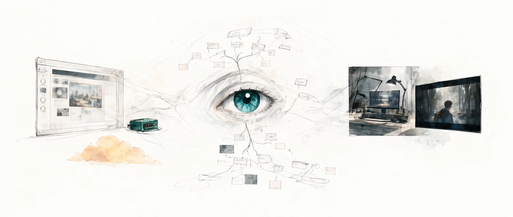

<div align="center">



# NexcoreMultimodalSkill

### Give text-only agents eyes, an image editor, and a video generator

[](https://www.python.org/)
[](LICENSE)
[]()

</div>

NexcoreMultimodalSkill combines two capabilities in one Agent Skill:

- **Visual input** through `vision.py`: inspect images, screenshots, charts, PDFs,
  Office files, and other documents with browser or API engines, fallback, and
  disk caching.
- **Media output** through `agnes_api.py`: generate images, edit images, generate
  videos, and query asynchronous video tasks through Agnes AI.

The two CLIs remain separate on purpose. A text-only agent gets a small, explicit
choice between reading existing content and generating new content.

## Quick start

```bash
git clone https://github.com/yan-stone-computer/NexcoreMultimodalSkill.git
cd NexcoreMultimodalSkill
python scripts/install.py --all
```

Or install into one platform:

```bash
python scripts/install.py --target claude
python scripts/install.py --target codex
python scripts/install.py --target opencode
python scripts/install.py --target cursor
python scripts/install.py --target trae
python scripts/install.py --target workbuddy
```

## Read an image or document

```bash
python scripts/vision.py screenshot.png --prompt "What error is shown and how do I fix it?"
python scripts/vision.py chart.png --prompt "Extract the key values and trends"
python scripts/vision.py before.png after.png --prompt "Compare the differences"
python scripts/vision.py paper.pdf                    # MinerU → Markdown
python scripts/vision.py screenshot.png --json        # Structured result
```

Images default to browser-driven web engines. When no browser is available or
the web route is unavailable, `vision.py` falls back through the configured
vision providers and local OCR. Documents route to MinerU.

```text
web → GLM → Qwen → SiliconFlow → Gemini → MinerU → local OCR
```

Use `--engine <name>` to force an engine. Use
`VISION_ENGINE_PRIORITY="gemini,glm,mineru,local"` to change the API fallback
order.

## Generate or edit media

Agnes commands require `AGNES_API_KEY`.

```bash
# Text → image
python scripts/agnes_api.py image \
  --prompt "A quiet tea house in the rain, cinematic lighting" \
  --size 2K --ratio 16:9 --download

# Image → image
python scripts/agnes_api.py image-edit \
  --prompt "Transform this photo into a watercolor painting" \
  --image photo.jpg --download

# Text → video
python scripts/agnes_api.py video \
  --prompt "A cat walking on a beach at sunset, tracking shot" \
  --mode text --seconds 5 --aspect-ratio 16:9 --wait --download

# Image → video (use a public image URL)
python scripts/agnes_api.py video \
  --prompt "Animate the waves gently" \
  --mode text --images https://example.com/photo.png --wait --download

# Keyframe animation
python scripts/agnes_api.py video \
  --prompt "Smooth transition from day to night" \
  --mode keyframe \
  --first-frame https://example.com/day.png \
  --last-frame https://example.com/night.png \
  --wait --download
```

Query an existing video task:

```bash
python scripts/agnes_api.py video-status --video-id <video-id> --download
```

Generated files are saved to the Desktop by default. Override this with
`AGNES_OUTPUT_DIR`.

## API keys

Create `.env` from `.env.example`:

```text
ZHIPUAI_API_KEY=
DASHSCOPE_API_KEY=
SILICONFLOW_API_KEY=
GEMINI_API_KEY=
MINERU_TOKEN=
AGNES_API_KEY=
AGNES_BASE_URL=https://apihub.agnes-ai.com/v1
```

At least one relevant provider key is enough for its route. Local OCR and the
tokenless limits offered by document providers work without a key. Provider
quotas and model availability are controlled upstream and may change.

Persist a key without editing `.env`:

```bash
python scripts/set_key.py glm sk-xxxx
python scripts/set_key.py gemini sk-xxxx
python scripts/set_key.py mineru your-token
python scripts/set_key.py agnes sk-xxxx
python scripts/set_key.py --list
```

Real environment variables take precedence over `.env`, which takes precedence
over the persisted key file at `~/.vision-reader/config.json`.

## Agent integration

The repository contains a standard `SKILL.md`, so it can be copied into any
platform that supports Agent Skills. The installer also creates native config
files for Codex, OpenCode, Cursor, Trae, WorkBuddy, and Claude Code.

For an agent without a skill loader, provide these two command entry points:

```bash
python <skill-dir>/scripts/vision.py <file-or-url> --prompt "<question>"
python <skill-dir>/scripts/agnes_api.py <command> [options]
```

## Project structure

```text
NexcoreMultimodalSkill/
├── SKILL.md                     # Agent routing and response rules
├── scripts/
│   ├── vision.py                # Image/document understanding
│   ├── agnes_api.py             # Image/video generation and analysis
│   ├── set_key.py               # Persist provider keys
│   ├── install.py               # Cross-platform installer
│   └── engines/                 # Vision providers and local fallback
├── references/
│   ├── web-engines.md           # Browser-driven vision SOP
│   └── agnes-api.md             # Agnes API reference
├── docs/media/                  # Image/video demo assets
└── tests/                       # Offline contract and payload tests
```

## Migration notice

This repository replaces:

- `yan-stone-computer/ModelVisionSkill`
- `yan-stone-computer/text-model-multimodal-skill`

The old repository URLs redirect to this project after the GitHub rename. The
old media repository is archived as a migration pointer; existing command names
inside `agnes_api.py` remain available for compatibility.

## License

[MIT](LICENSE) © NexcoreMultimodalSkill contributors
